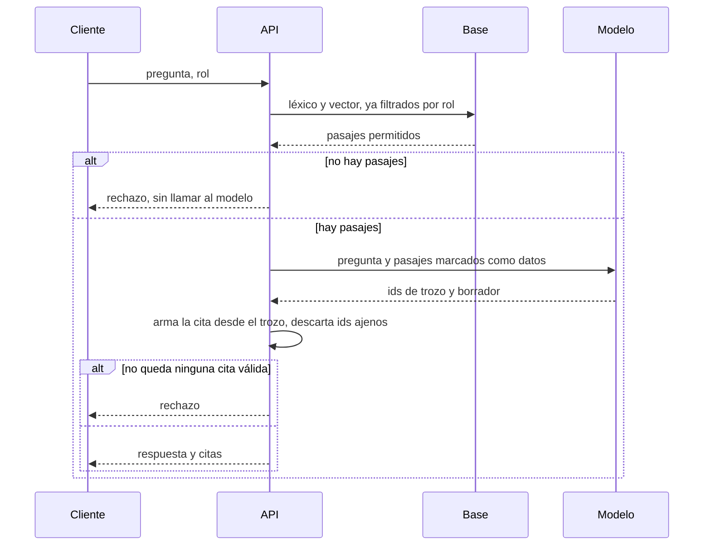

# ARCHITECTURE — Anchora

Estado: Aprobada
Fecha: 2026-10-23

Este documento manda sobre el código de esta versión. Las decisiones caras de revertir están en [los ADR](../adr/README.md).

- [CONTEXT.md](CONTEXT.md) — quién usa el sistema y qué queda fuera
- [DATA.md](DATA.md) — trozos, identidad, búsqueda
- [EVALUATION.md](EVALUATION.md) — qué número cuenta y qué número no
- [SECURITY.md](SECURITY.md) — qué está cerrado y qué hueco se admite

## Forma

Un proceso. Una base PostgreSQL. Sin microservicios: no hay un límite de dominio que justifique otro despliegue, y un fallo de red entre “retrieval” y “generación” no aporta nada con este tamaño.

El modelo no escribe la cita. Elige identificadores. El servidor copia el extracto desde el trozo que ya recuperó. Si el identificador no estaba en ese conjunto, se tira. Si no queda ninguno, hay rechazo y el borrador no se entrega. Así una cita no puede apuntar a texto que el modelo haya inventado. El costo es que una paráfrasis correcta, sin usar el id, cuenta como rechazo. Es el trade-off de [ADR-0001](../adr/0001-excerpt-comes-from-the-chunk.md).

El orden de las citas es el de los ids del modelo. Un id repetido se publica una vez, en su primera aparición. El extracto es el texto completo de la ventana recuperada. Un id repetido dentro de lo recuperado es un error de la búsqueda, no una cita doble. El rechazo porque la búsqueda no devolvió filas es otro (`no_evidence`) y ocurre antes de llamar al modelo.

## Módulos

| Módulo | Puede importar | No puede |
| --- | --- | --- |
| `domain` | nada de infraestructura | Postgres, HTTP, SDK del modelo |
| `application` | `domain` y puertos | drivers concretos |
| `infrastructure` | puertos | handlers HTTP |
| `api` | casos de uso | SQL |

Un test de arquitectura, cuando exista el paquete, falla si `domain` importa `infrastructure` o `api`. Hasta ese commit, la regla está escrita aquí para no abrir el código en la dirección contraria.

## Contrato HTTP

`POST /v1/answers`

Entrada: `question` (texto no vacío, tope de longitud) y `role` (`operator` o `auditor`).

Salida 200:

- `refused: false`, `answer`, `citations[]` con `chunk_id`, documento, sección, página y `excerpt` copiado del trozo
- o `refused: true`, `reason` (`no_evidence` o `no_valid_citation`), `citations: []`

No es un error que el manual no contenga la respuesta. El error es de transporte, de entrada o del proveedor.

Errores en `application/problem+json`:

| Caso | Estado |
| --- | --- |
| Pregunta vacía, rol desconocido, cuerpo ilegible | 400 |
| El modelo no responde a tiempo | 504 |
| El modelo responde algo que no cumple el esquema, después de un reintento | 502 |
| La base no está | 503 |

Cada respuesta lleva `request_id`. El log de una respuesta contestada o rechazada incluye rol, latencias de búsqueda y de generación, nombre del modelo, tokens de entrada y de salida, ids usados y si hubo rechazo. No incluye la clave. La pregunta sí se registra en esta versión porque el corpus es sintético y sin ella no se depura el retrieval. El día que el corpus tenga datos de personas, ese campo se apaga. Está en [SECURITY.md](SECURITY.md).

## Qué no se esconde

Esta versión no mide si la respuesta se sigue del pasaje. Mide si el pasaje correcto apareció y si la cita es texto real. Un modelo puede citar un trozo cercano y decir otra cosa. Ese hueco se cierra con un juez contrastado, en este mismo repositorio, cuando recall y validez de cita ya se imprimen. No antes: un juez sobre retrieval roto solo pone un número elegante.

Tampoco hay umbral mágico de similitud. Las escalas léxica y vectorial no se suman. Si la fusión devuelve pasajes, el modelo los ve. El rechazo por “no hay nada” ocurre cuando la búsqueda no devuelve filas para ese rol, o cuando el modelo no elige un id permitido. Afinar un corte de score sin un conjunto medido sería un número inventado.

## Idioma

Los manuales, el README, la API, los tests y los commits de esta versión están en inglés. Esta arquitectura y los ADR están en español. La búsqueda léxica usa el diccionario `english`. [ADR-0008](../adr/0008-public-corpus-is-english.md).

## Versión siguiente, todavía no

Juez de faithfulness, después de que recall y validez de cita se impriman. Rerank comparado contra la fusión actual. Un índice aproximado solo con latencia y hit@5 medidos. Un manual en español, con el diccionario `spanish` y las mismas métricas antes y después. Trazas, y un MCP cuando otro proceso llame a esta API. Interfaz web. AWS cuando el servicio ya corra en Docker, con el mismo contenedor y sin NAT gateway.
